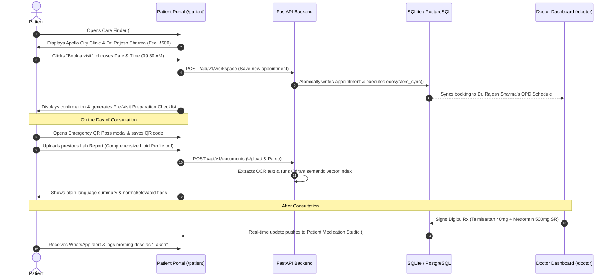
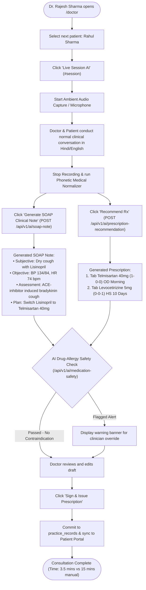
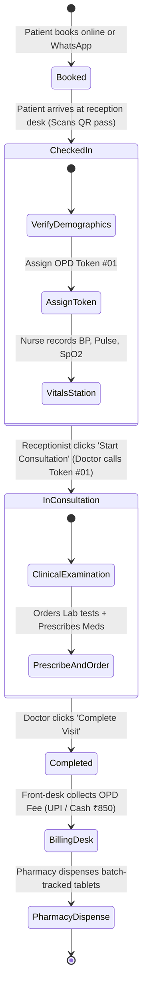
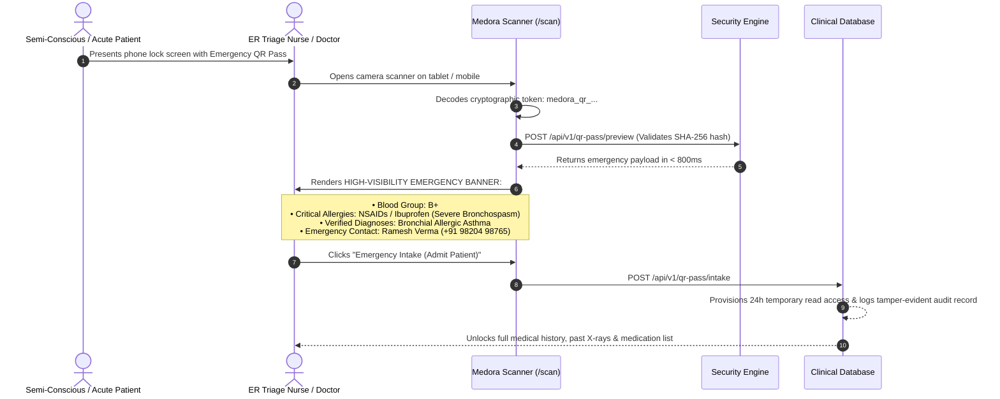
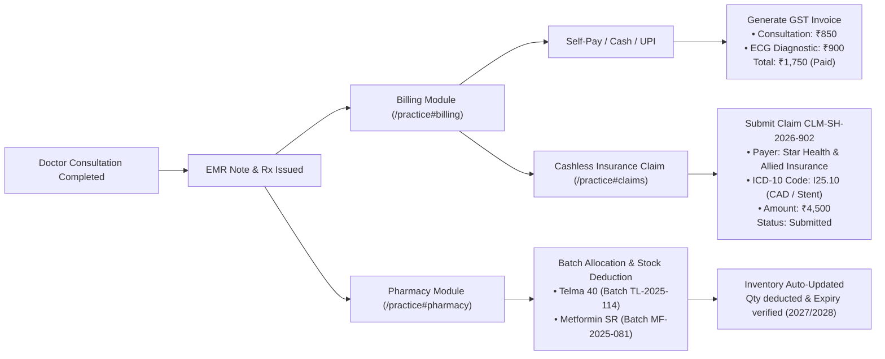
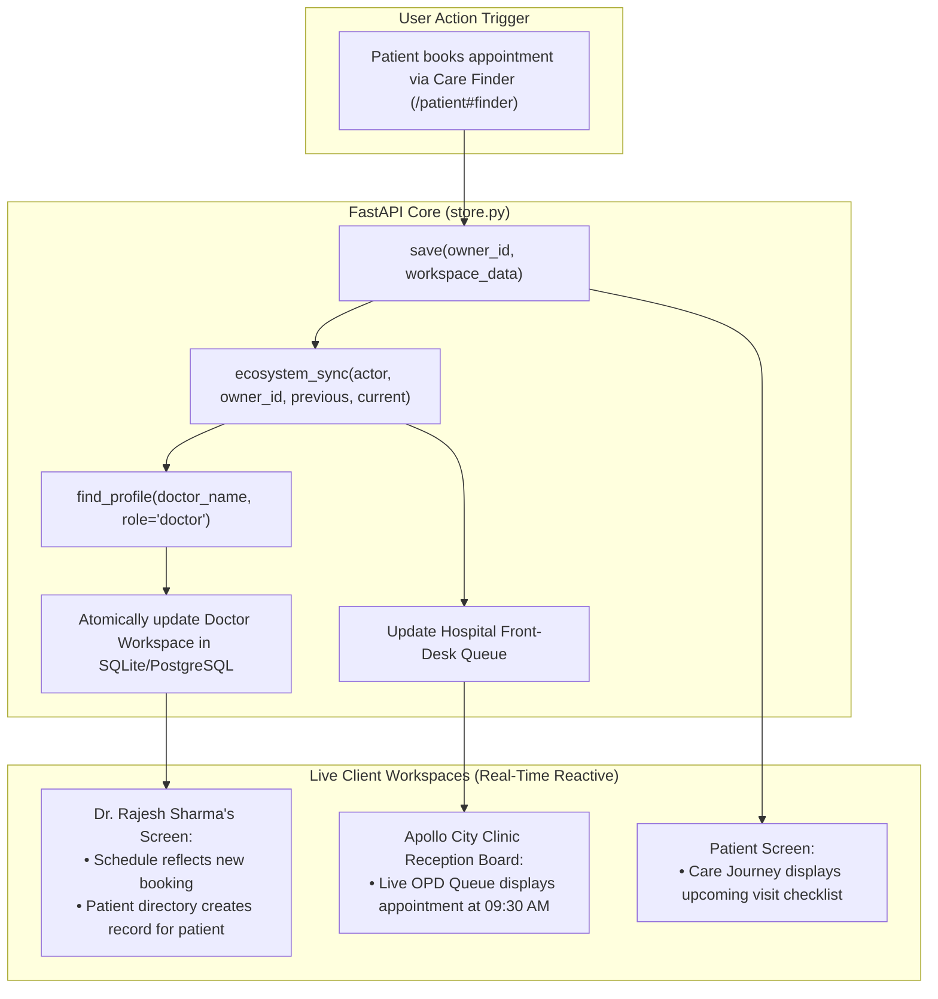

# Medora — Complete Product Features, Functionalities & End-to-End Workflows

> **Purpose of this Document:**  
> This specification provides an exhaustive, production-grade breakdown of all capabilities, interfaces, database entities, and end-to-end user flows in the **Medora Connected Healthcare Operating System**.  
> It is structured to directly serve as the design brief for **product videos, animated UI flow walkthroughs, marketing brochures, pitch decks, and architectural diagrams**.

---

## Table of Contents
1. [Product Overview & Value Proposition](#1-product-overview--value-proposition)
2. [Master Feature Catalog by Role & Module](#2-master-feature-catalog-by-role--module)
   - [2.1 Patient Care Portal (`/patient`)](#21-patient-care-portal-patient)
   - [2.2 Doctor / Clinician Workspace (`/doctor`)](#22-doctor--clinician-workspace-doctor)
   - [2.3 Hospital Operations Hub (`/hospital`)](#23-hospital-operations-hub-hospital)
   - [2.4 Medora Practice Enterprise Suite (`/practice`)](#24-medora-practice-enterprise-suite-practice)
   - [2.5 Emergency QR Quick-Pass & Scanner (`/scan`)](#25-emergency-qr-quick-pass--scanner-scan)
3. [Deep-Dive Workflow Flows (Ready for Visual Storyboarding)](#3-deep-dive-workflow-flows-ready-for-visual-storyboarding)
   - [Flow A: The Complete Patient Journey](#flow-a-the-complete-patient-journey-discovery--booking--care--adherence)
   - [Flow B: Doctor Ambient AI Consultation Workflow](#flow-b-doctor-ambient-ai-consultation-workflow)
   - [Flow C: Hospital OPD Front-Desk & Triage Queue Flow](#flow-c-hospital-opd-front-desk--triage-queue-flow)
   - [Flow D: Emergency Room (ER) Quick-Pass Triage Flow](#flow-d-emergency-room-er-quick-pass-triage-flow)
   - [Flow E: Practice Billing, Pharmacy Dispensation & Insurance Claim Flow](#flow-e-practice-billing-pharmacy-dispensation--insurance-claim-flow)
   - [Flow F: Real-Time Ecosystem Synchronization Architecture](#flow-f-real-time-ecosystem-synchronization-architecture)
4. [Color Codes, Terminology & Visual Asset Cues](#4-color-codes-terminology--visual-asset-cues)

---

## 1. Product Overview & Value Proposition

**Medora** is an AI-native, unified healthcare operating system tailored for clinics, polyclinics, hospitals, clinicians, and patients across India. It bridges the critical divide between patient engagement, doctor consultation speed, and hospital administrative operations.

### Core Value Pillars
* **For Doctors:** Saves 3–4 hours daily on paperwork with an Ambient AI consultation assistant that generates complete, structured SOAP notes and digital prescriptions in Indian clinical formats (`1-0-1`, `1-0-0`, after meals) in one click.
* **For Patients:** Plain-language health records, simplified medical summaries, instant appointment booking, automated medication dose schedules, and an offline-verifiable Emergency QR Quick-Pass.
* **For Hospitals & Clinics:** Zero-leakage OPD token queues, waiting list prioritization, IPD bed allocations, inventory and batch-tracked pharmacy, GST billing in INR (`₹`), and TPA insurance claim lifecycle management.
* **Architecture:** Dual storage model supporting browser-local rapid evaluation, SQLite local-first clinic servers, and cloud Supabase/PostgreSQL scale, protected by DPDP (Digital Personal Data Protection) compliance.

---

## 2. Master Feature Catalog by Role & Module

```
                                  ┌───────────────────────────────┐
                                  │       MEDORA PLATFORM         │
                                  └───────────────┬───────────────┘
            ┌───────────────────────────┬─────────┴─────────┬───────────────────────────┐
            ▼                           ▼                   ▼                           ▼
  ┌───────────────────┐       ┌───────────────────┐ ┌───────────────┐        ┌───────────────────┐
  │  PATIENT PORTAL   │       │ DOCTOR WORKSPACE  │ │ HOSPITAL HUB  │        │  MEDORA PRACTICE  │
  │    (`/patient`)   │       │    (`/doctor`)    │ │ (`/hospital`) │        │   (`/practice`)   │
  └───────────────────┘       └───────────────────┘ └───────────────┘        └───────────────────┘
```

---

### 2.1 Patient Care Portal (`/patient`)

Designed for individuals and families managing chronic conditions (e.g. Diabetes, Hypertension, Asthma, Thyroid disorders).

| Feature Name | View / Route | Description & Capabilities | Key User Actions |
| :--- | :--- | :--- | :--- |
| **Personal Care Dashboard** | `/patient` | Unified view of upcoming visits, vitals summary, recent diagnostic lab documents, and today's medication timeline. | View confirmed appointments, open Emergency Pass, launch AI voice assistant. |
| **Clinic & Specialist Directory** | `/patient#finder` | Regional search engine for clinics, diagnostics, and specialists (Bandra West, Khar, Juhu, etc.) with language, accessibility, and urgency filters. | Filter by specialty (Cardiology, Dermatology, etc.), preview fees (`₹500`), book appointment. |
| **Appointment Manager** | `/patient#appointments` | Complete schedule of active, past, and cancelled visits. Includes dynamic preparation checklists (medication lists, past lab sheets). | Book new slot, reschedule time, view consultation mode (In-person / Video), cancel booking. |
| **Document Intelligence & Vault** | `/patient#documents` | Secure health document storage. Performs client/server PDF text parsing, OCR, and AI translation into plain English, Hindi, and regional languages. | Upload PDF/image, view automated clinical findings, download layman summary, search via semantic RAG. |
| **Medication Rhythm Studio** | `/patient#medications` | Visual daily medication tracker showing scheduled times (Morning, Afternoon, Bedtime). Tracks adherence percentages and logs taken doses. | Mark dose as taken, toggle WhatsApp refill alerts, check generic Indian Jan Aushadhi alternatives. |
| **Care Journey & Tasks** | `/patient#journey` | Clinician-prescribed recovery milestones, lifestyle targets, diagnostic test reminders, and follow-up checklists. | Check off completed tasks, view target dates, track recovery progress bars. |
| **Live AI Health Navigator** | `/patient#navigator` | Conversational RAG assistant answering patient questions based on their uploaded blood reports and prescriptions. Never hallucinates diagnoses. | Chat with Medora AI, ask "What did my lipid panel say?", request diet guidance. |
| **Emergency QR Quick-Pass** | Modal (`#qr-pass`) | Cryptographically signed digital pass containing blood group, emergency contacts, critical allergies, and verified conditions. | Generate temporary (24h) or lifetime pass, download SVG, display on lock screen. |
| **Family & Dependent Access** | `/patient#family` | Proxy healthcare management for elderly parents, spouses, and children under a single authenticated account. | Add family member, switch active profile, book consultations on behalf of dependents. |
| **Privacy & Access Vault** | `/patient#privacy` | Fine-grained data access controls. Shows exactly which doctors or hospital coordinators currently hold view or edit permissions. | Grant new clinician access, revoke existing permissions, download tamper-proof JSON audit log. |

---

### 2.2 Doctor / Clinician Workspace (`/doctor`)

Tailored for general physicians, specialists, and visiting consultants in Indian OPD clinics.

| Feature Name | View / Route | Description & Capabilities | Key User Actions |
| :--- | :--- | :--- | :--- |
| **Clinical Overview** | `/doctor` | Real-time cockpit showing today’s OPD appointments, checked-in arrival queue, completed visits, and registered patients. | One-tap "Prepare Next Consultation", scan incoming patient QR pass, open Live AI session. |
| **Ambient AI Consultation Studio** | `/doctor#session` | Real-time speech transcription that listens to doctor-patient conversations and automatically structures them into formal medical records. | Record audio, run Medical Phonetic Correction, generate SOAP clinical note, recommend digital Rx. |
| **Doctor Copilot & Clinical Guidance**| `/doctor#consultation` | AI clinical co-pilot analyzing patient history, allergies, and current symptoms to suggest differentials and guideline-backed next steps. | Review diagnostic flags, verify drug-allergy contraindications, copy briefing into EMR. |
| **Digital Prescription Studio (Rx)** | `/doctor#prescriptions`| Indian-standard prescription composer supporting branded & generic formulations (Telma, Metformin SR, Thyronorm, Foracort). | Auto-fill dosage timings (`1-0-1`), set duration (14 days), check allergy safety, sign & issue Rx. |
| **OPD Schedule & Calendar** | `/doctor#schedule` | Day-by-day and multi-date consultation calendar with filtering by status (*Confirmed, Checked in, In consultation, Completed*). | Review booked slots, add manual walk-in appointment, filter by consultation date. |
| **Patient Directory** | `/doctor#patients` | Comprehensive registry of all authorized patients with risk tags (*High, Medium, Low*), chronic condition summaries, and visit histories. | Search patient by name or phone, view clinical summary, launch consultation room. |
| **Clinical Notes Archive** | `/doctor#notes` | Chronological repository of all recorded SOAP progress notes, triage assessments, and discharge summaries. | Search past clinical entries, filter by patient ID, export notes to text/PDF. |
| **Specialist Referrals** | `/doctor#referrals` | Structured formal referral letter generator connecting primary care physicians to secondary specialists (Cardiologists, Orthopedics). | Draft referral notes, select target specialty, assign follow-up tasks to patient portal. |

---

### 2.3 Hospital Operations Hub (`/hospital`)

Designed for hospital coordinators, clinic front-desk managers, OPD receptionists, and nursing station staff.

| Feature Name | View / Route | Description & Capabilities | Key User Actions |
| :--- | :--- | :--- | :--- |
| **Central Operations Cockpit** | `/hospital` | Real-time command center showing today's total OPD appointments, live checked-in waiting queue, finished visits, and waiting list count. | Open live token queue, review clinic insights, register new walk-in patient. |
| **Live Patient Token Queue** | `/hospital#queue` | Digital visual token board tracking patient flow: `Confirmed` $\rightarrow$ `Checked in` $\rightarrow$ `In consultation` $\rightarrow$ `Completed`. | Click "Check in patient", notify doctor room, mark visit completed, inspect patient details. |
| **Waiting-List Intelligence** | `/hospital#waiting` | Algorithmic prioritization of backlog patients waiting for specialist slots based on urgency and elapsed waiting days. | Filter by priority (High/Med/Low), click "Offer sample slot" to send instant slot booking alert. |
| **Care Team Duty Roster** | `/hospital#team` | Real-time staffing roster tracking availability across all active clinic doctors and medical specialists. | Toggle on-duty status switches (`Available` / `Off duty`), view assigned OPD rooms. |
| **Patient Communications Hub** | `/hospital#communications`| Multi-channel automated messaging center drafting and sending WhatsApp and SMS notifications. | Dispatch appointment confirmations, slot offers, and medication refill alerts. |
| **Operational Analytics & Intelligence**| `/hospital#analytics` | Dynamic data analytics displaying day-by-day attendance trends, specialty demand forecasts, and patient condition distributions. | Filter by timeframe (*This week, This month, 3 months*), export CSV analytics reports. |
| **Workplace & Preventive Health** | `/hospital#employer` | Community and corporate wellness tracking (e.g. Diabetes screening programs, cardiac checkups). | Create wellness program, track participant engagement percentages. |

---

### 2.4 Medora Practice Enterprise Suite (`/practice`)

Enterprise-grade, multi-branch practice management stored in relational SQLite / PostgreSQL with optimistic concurrency control (CAS) and immutable audit logging.

```
┌──────────────────────────────────────────────────────────────────────────┐
│                   MEDORA PRACTICE MODULE ARCHITECTURE                    │
└────────────────────────────────────┬─────────────────────────────────────┘
         ┌───────────────────────────┼───────────────────────────┐
         ▼                           ▼                           ▼
  [ CLINICAL CORE ]           [ ADMINISTRATIVE ]           [ LOGISTICS & LAB ]
  • patients (Registry)       • appointments (Bookings)   • pharmacy (Batches/Rx)
  • emr (Encounter Notes)     • billing (GST Invoices)    • labs (Test Orders/Panels)
  • treatments (Care Plans)   • claims (TPA/Insurance)    • ipd (Beds/Admissions)
  • prescriptions (Signed Rx) • crm (Inquiries/Leads)     • inventory (Consumables)
  • consent (DPDP Forms)      • hr (Staff Rosters)        • telemedicine (Video Rooms)
  • templates (SOAP Layouts)  • communications (WhatsApp) • locations (Clinic Branches)
```

1. **`locations` (Branch Network):** Multi-branch clinic management (e.g. *Bandra West Flagship, Pali Hill Annex*) with operating hours, phone lines, and timezone anchoring (`Asia/Kolkata`).
2. **`patients` (Patient Master Index):** Demographics, emergency contacts, known drug allergies, DOB, and unified lifetime IDs.
3. **`appointments` (Multi-Clinician Booking):** Non-overlapping calendar slots with collision detection preventing double-booking of doctors or rooms.
4. **`emr` (Clinical Encounter Worksheets):** Structured encounter forms capturing Chief Complaint, Vitals, Observations, Assessment, and Plan.
5. **`treatments` (Care & Procedure Plans):** Long-term intervention tracking with defined goals, clinical procedures, progress milestones, and review dates.
6. **`prescriptions` (Digital Pharmacy Orders):** Formulation details, strengths, dosage schedules, allergy verification checks, and review intervals.
7. **`billing` (Invoices & GST Receipts):** Itemized bills for OPD consultations, diagnostic tests, and procedures in Indian Rupee (`₹ / INR`) with UPI/Cash/Card reconciliation.
8. **`claims` (Insurance & TPA Claims):** Health insurance cashless pre-auth and claim filing with ICD-10 diagnostic coding (e.g., Star Health, Care Health, HDFC ERGO).
9. **`pharmacy` (Batch-Tracked Inventory):** Drug stocks with batch numbers, unit packaging (strips/bottles), expiry tracking, and auto-reorder triggers.
10. **`labs` (Diagnostic Test Orders):** Pathology and radiology orders (HbA1c, Complete Lipid Panel, Thyroid T3/T4/TSH, 12-lead ECG) with specimen tracking and clinician sign-off.
11. **`ipd` (Inpatient & Daycare Bed Allocation):** Bed-occupancy matrix with collision prevention (preventing two patients from being assigned the same bed in Day Care or Deluxe Wards).
12. **`inventory` (Medical Consumables & PPE):** Stock management for syringes, examination gloves, N95 masks, and ECG electrodes with SKU tracking.
13. **`crm` (Patient Acquisition & Leads):** Inquiry funnel tracking lead sources (WhatsApp business, Practo, Google profile) with DPDP marketing consent verification.
14. **`communications` (Message Outbox):** Automated notification engine dispatching appointment reminders and follow-up templates.
15. **`hr` (Staff Duty Shift Rosters):** Doctor and nurse shift schedules (OPD shifts, triage shifts, night coverage).
16. **`telemedicine` (HD Video Consultation):** WebRTC and Jitsi-powered encrypted virtual consultations with waiting rooms and active-speaker highlighting.
17. **`templates` (Standardized Clinical Layouts):** Pre-configured clinical templates (Indian OPD SOAP Format, Minor Surgery Discharge Summaries).
18. **`consent` (Digital Personal Data Protection):** Electronic consent records capturing patient signatures and OTP validations for medical treatments and data sharing.

---

### 2.5 Emergency QR Quick-Pass & Scanner (`/scan`)

A life-saving zero-friction intake module designed for hospital emergency rooms and OPD front desks.

* **For Patients (`/patient`):** 
  - Generates an encrypted, signed QR code pass.
  - Can be set as **Temporary (24 Hours)** for hospital visits or **Lifetime** for chronic care.
  - Can be saved as an offline image or printed as a physical card.
* **For Hospital / Doctor (`/scan`):**
  - Instant live web camera scanner or USB hardware barcode scanner.
  - **Zero-Login Quick Triage:** Displays red allergy alert badges, emergency contact phone numbers, current medications, and blood group in under 2 seconds.
  - **One-Tap Clinical Intake:** Authenticated doctors click "Intake Patient" to immediately grant temporary chart access and import the patient into the active queue.

---

## 3. Deep-Dive Workflow Flows (Ready for Visual Storyboarding)

---

### Flow A: The Complete Patient Journey (Discovery $\rightarrow$ Booking $\rightarrow$ Care $\rightarrow$ Adherence)



#### Step-by-Step Storyboard Breakdown
1. **Discovery:** Patient opens **Care Finder**, enters area "Bandra West", filters by specialty "General Medicine", and selects **Dr. Rajesh Sharma**.
2. **Booking:** Patient selects consultation mode (In-person), selects 09:30 AM slot, enters reason "Diabetes & BP 3-Month Follow-Up", and confirms.
3. **Automated Sync:** Backend automatically syncs this booking into the doctor's calendar and the hospital's live token queue.
4. **Pre-Consultation Preparation:** Patient accesses the **Visit Preparation Checklist**; ticks off *"Have previous prescription ready"* and *"Fast for 10 hours for blood test"*.
5. **Report Upload:** Patient uploads a PDF of their recent lipid profile. Medora extracts cholesterol levels and displays an easy-to-read breakdown.
6. **Post-Visit Adherence:** The doctor's signed prescription appears immediately in the patient's **Medication Rhythm Studio** with schedule badges (`1-0-0` morning after breakfast). The patient marks their first dose as taken.

---

### Flow B: Doctor Ambient AI Consultation Workflow



#### Step-by-Step Storyboard Breakdown
1. **Patient Queue Call:** Dr. Rajesh Sharma opens `/doctor`, sees **Rahul Sharma** checked in at Token #1, and clicks **"Prepare Consultation"**.
2. **Audio Activation:** Doctor clicks **"Live Session AI"** and activates the microphone. The patient discusses feeling fatigued and developing a dry cough on their current blood pressure tablet.
3. **Medical Phonetics Correction:** The audio stream captures natural speech; Medora automatically normalizes clinical phonetics (e.g. converting spoken *"telma forty once morning"* into formal Latin dosage instructions).
4. **Automated SOAP Drafting:** Doctor clicks **"Generate SOAP Note"**. Medora structures the subjective symptoms, objective vital recordings, clinical assessment, and step-by-step treatment plan.
5. **AI Prescription Studio:** Doctor clicks **"Recommend Rx"**. Medora detects the dry cough is an adverse ACE-inhibitor effect and recommends switching to **Telmisartan 40mg OD** with **Levocetirizine 5mg** for cough relief.
6. **Safety Review & Sign:** Doctor reviews the note, verifies no drug-allergy interactions, clicks **"Sign & Issue"**, and the prescription is instantly delivered to the patient's smartphone.

---

### Flow C: Hospital OPD Front-Desk & Triage Queue Flow



#### Step-by-Step Storyboard Breakdown
1. **Patient Arrival:** Patient walks up to the Apollo City Clinic reception desk.
2. **Contactless Token Check-In:** Receptionist opens `/hospital#queue` and clicks **"Check in patient"** (or scans the patient's Emergency QR Pass). Patient moves to the `Checked in` state.
3. **Triage & Vitals:** The triage nurse records blood pressure (124/82 mmHg) and blood glucose (114 mg/dL), adding them to the live encounter worksheet.
4. **Consultation Initiation:** When Consultation Room 1 is ready, receptionist clicks **"Start consultation"**; status updates to `In consultation` across doctor and patient screens.
5. **Discharge & Cashier Settlement:** Clinician finishes notes; status updates to `Completed`. Receptionist generates GST Invoice `INV-2026-0841` for **₹850**, receives payment via UPI QR, and issues a digital receipt.

---

### Flow D: Emergency Room (ER) Quick-Pass Triage Flow



#### Step-by-Step Storyboard Breakdown
1. **Emergency Presentation:** A patient experiencing acute asthma flare-up arrives at the Emergency Department unable to speak clearly.
2. **Instant Scan:** The triage nurse points the scanner (`/scan`) at the patient's physical card or phone lock screen.
3. **Instant Critical Alert:** Within 800 milliseconds, the screen flashes a bright red alert banner: **Allergy Warning: NSAIDs / Aspirin triggers acute bronchospasm**.
4. **Accident Prevention:** The medical team immediately avoids administering contraindicated painkillers and prepares nebulization with Levosalbutamol.
5. **Audit Logging:** The system records an immutable audit entry (`Triage QR Intake by Nurse Kavita Nair`) ensuring legal and DPDP data compliance.

---

### Flow E: Practice Billing, Pharmacy Dispensation & Insurance Claim Flow



#### Step-by-Step Storyboard Breakdown
1. **Order Generation:** Clinician finishes consultation, prescribing medications and ordering an ECG.
2. **Billing Generation:** Front desk creates invoice `INV-2026-0843` for **₹1,750** with itemized breakdown for consultation and 12-lead ECG.
3. **Insurance / TPA Pre-Authorization:** If covered by corporate health insurance, coordinator opens `/practice#claims`, selects **Star Health**, attaches ICD-10 code `I25.10`, and submits for cashless pre-auth.
4. **Batch-Tracked Pharmacy Dispensing:** Hospital pharmacy opens `/practice#pharmacy`, looks up prescribed batch `TL-2025-114`, dispenses the strips, and stock quantity is automatically decremented from 420 to 418 with expiry verification.

---

### Flow F: Real-Time Ecosystem Synchronization Architecture



---

## 4. Color Codes, Terminology & Visual Asset Cues

Use these guidelines when generating marketing graphics, brochure illustrations, and video motion designs:

### Primary Palette & Brand Identifiers
* **Medora Teal (`#0d9488` / `#0f766e`):** Primary clinician color, clinical verification badges, prescription signed status.
* **Deep Navy (`#0f172a` / `#1e293b`):** Primary typography, high-contrast headings, enterprise structure.
* **Alert Crimson (`#ef4444` / `#b91c1c`):** Emergency QR pass, critical drug allergy banners, overdue tasks.
* **Care Blue (`#2563eb` / `#3b82f6`):** Hospital coordinator tags, appointment times, patient profile icons.
* **Success Emerald (`#10b981` / `#059669`):** Paid billing receipts, completed consultations, normotensive vital flags.
* **Currency Symbol:** Always format currency in Indian Rupee (**`₹`**), e.g. `₹500 (OPD Fee)`, `₹1,200 (Specialist Consultation)`.

### Screen Captures Recommended for Video Demo
1. **Scene 1 (The Hook):** Patient opens Emergency QR Quick-Pass on mobile; emergency room scanner immediately detects penicillin and NSAID allergy in under 1 second.
2. **Scene 2 (The Consultation):** Dr. Rajesh Sharma engages in normal doctor-patient dialogue; Medora's ambient AI converts the conversation into a finalized SOAP clinical note.
3. **Scene 3 (The Front Desk):** Apollo City Clinic front-desk token queue moving a patient smoothly from `Checked in` to `In consultation` with zero paper sheets.
4. **Scene 4 (The Practice ERP):** Medora Practice dashboard showing real-time revenue, active day-care beds, and pharmacy batch stocks with zero friction.

