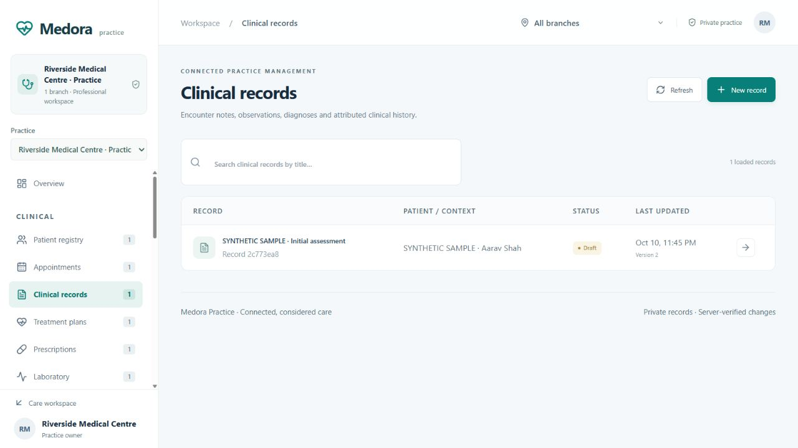
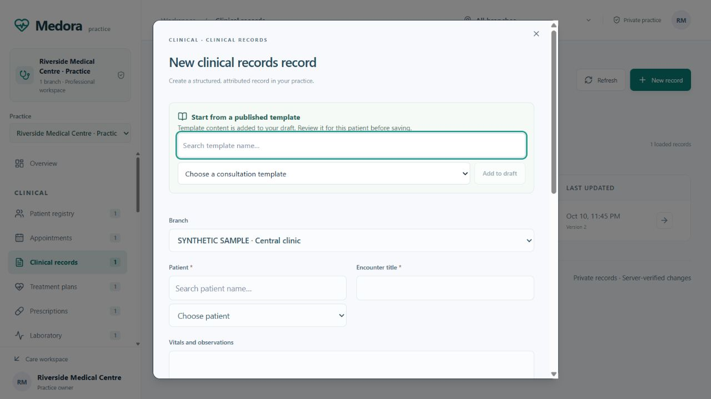
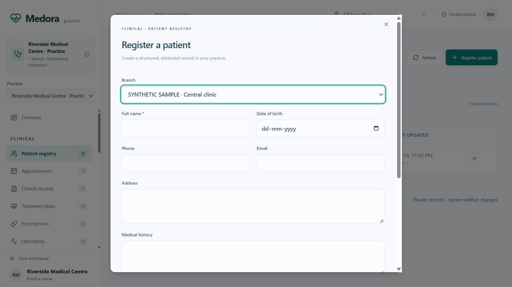
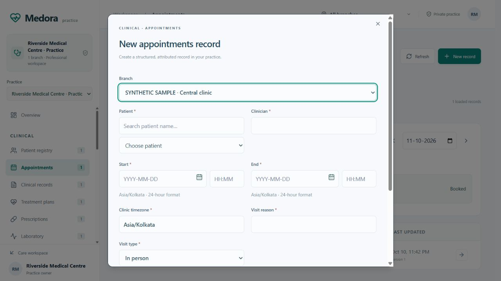
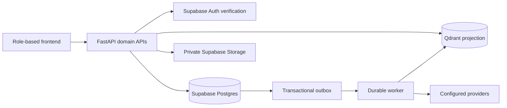

# Medora: UX, workflows, and backend redesign

Date: 11 October 2026. Status: initial redesign implemented and verified locally.
The scope and roadmap below retain the original audit findings. See
[implementation status](C:/Users/Dell/Downloads/medora-fullstack/medora-fullstack/docs/design/2026-10-11/implementation-status.md)
for the changes delivered, verification evidence, and remaining work.

The immediate goal is to reduce form fatigue and make the next useful action obvious.
The larger goal is one connected patient journey, backed by explicit domain rules,
rather than 18 unrelated record editors. Preserve Supabase as the transactional source
of truth and Qdrant as an authorized document-search projection.

## 1. What was inspected

Fresh browser captures from the running, authenticated Supabase hospital sample
practice are saved beside this document. Only synthetic sample records were visible.
Opening empty forms did not save any records. A separate source review examined the
frontend forms, legacy doctor workspace, backend routes, validation, permissions,
provider code, migrations, and tests.

| Step | Screen | Health | Finding |
|---|---|---|---|
| 1 | Clinical list | Readable, weak task framing | Clear typography/status and patient label, but generic New record action and module-centric navigation give little encounter context. |
| 2 | New clinical note | High friction | Template tools, branch and patient selection occupy most of the visible dialog before documentation begins. Clinical sections and save action require scrolling. |
| 3 | Patient registration | Excessive initial scope | Identity/contact fields share a long modal with address, medical history, allergies, and emergency contact. Optional clinical detail should not delay front-desk registration. |
| 4 | Appointment booking | Missing operational context | Manual clinician text, two date/time pairs, and editable timezone replace selection of an available slot. This form cannot show availability alongside the decision. |

Strengths worth retaining: calm teal identity, visible focus outline, readable labels,
patient names on lists, explicit draft/version states, branch context, and real audit
history. The issue is the interaction structure, not a need for more decoration.

Accessibility risks visible in these captures: substantial dialog scrolling, primary
actions outside the initial viewport, and competing setup controls before the main
task. Long forms also increase focus traversal. These captures do not establish
contrast compliance, screen-reader behavior, keyboard completion, or mobile quality;
those need explicit implementation tests.

Source evidence: `frontend/components/medora/practice-workspace.tsx` renders all
modules through one RecordEditor and one field loop. The catalog supplies input types
but no task sections, conditional stages, contextual defaults, or domain-specific
composers. Styling that same loop would preserve the underlying problem.

## 2. Product principles

1. Start from the user's task: Register patient, Book visit, Start consultation,
   Prepare prescription, Issue invoice, Receive stock. Avoid generic CRUD language.
2. Carry patient, branch, appointment and encounter context forward. Do not make users
   search the same patient in every module or re-enter known clinic details.
3. Ask only what is needed at this stage. Short tasks use a drawer; complex clinical
   work uses a dedicated workspace. Do not turn every task into a wizard.
4. Separate draft capture from review and finalization. Save draft must never imply
   a prescription is issued, a message delivered, a claim submitted, or money charged.
5. Keep actions and save state visible. Use meaningful summaries, short sections,
   and optional disclosure, rather than rows of large empty textareas.
6. Unknown is a real state. Missing age, allergies, results, consent, or delivery
   information must remain unknown; never silently fill it with plausible facts.
7. Match each role's responsibilities. Server permissions continue to govern reads,
   edits, signing, and branch access; visual hiding is not authorization.
8. Show genuine operational state. Counters, queues and availability must come from
   complete server queries, not one page of records or illustrative chart arrays.

## 3. Visual system and concept selection

Keep the recognizable teal heart brand, deep teal actions, ink text, and light neutral
surfaces. Use an 8px spacing rhythm, 14–16px input/body text, stronger section titles,
limited border/elevation, and Lucide icons. Let alignment and grouping provide visual
variety; do not use extra cards, gradients, or animation to disguise lengthy forms.

Three independent generated concepts were shown in this order:

| Displayed option | File | Interaction model | Tradeoff |
|---|---|---|---|
| 1 | option-1.png | Visit workspace: documentation canvas with section navigation and nearby visit history | More simultaneous context; needs careful density control. |
| 2 | option-2.png | Guided consultation: a focused stage with a clear review path | Less cognitive load; additional step transitions for experienced staff. |
| 3 | option-3.png | Clinical worksheet: compact summaries with one section expanded for editing | Fast scanning and flexible order; collapsed states must expose missing information clearly. |

These images are visual concepts with synthetic content, not implemented screens or
evidence of working new features. Any new vitals, orders, rich text, or checklist states
shown in them require typed APIs and persisted semantics before they become operational.
Do not copy generated contact details, clinical values, or hardcoded identities into
application defaults. The selected direction supplies hierarchy and layout; this
blueprint supplies the actual workflow and safety rules.

## 4. Information architecture and role entry points

Replace a flat feature inventory with role-specific starting tasks. Keep advanced
modules discoverable under a grouped secondary menu.

| Role | Default workspace | Frequent actions |
|---|---|---|
| Coordinator | Today: schedule, arrivals, cancellations, unresolved patient identity | Find/register patient, book/reschedule, check in, hand off |
| Clinician | Assigned queue and active encounter | Review history/allergies, document, order, prescribe, review/sign |
| Billing | Unissued invoices, receivables and payment exceptions | Compose, issue, collect, receipt, reconcile |
| Pharmacist | Dispensing work queue and stock exceptions | Verify prescription, choose batch, dispense, receive, quarantine |
| Laboratory | Orders by collection/result stage | Collect, enter/upload results, route for review |
| Owner | Operational exceptions and branch/staff management | Assign responsibilities, inspect finance, resolve blockers |

An encounter is the hub for clinical actions. Patient profile is the longitudinal
record. An appointment schedules a visit. These are related objects, not interchangeable
records. A receptionist should not need to navigate an EMR editor to complete arrival.

## 5. Task-specific screens and forms

| Module/task | Layout | Initially visible | Later or conditional content | Primary action |
|---|---|---|---|---|
| Patient registration | Compact drawer, duplicate search first | Name, DOB if known, phone, email; inherited branch summary | Address/emergency contact; clinician-only history/allergy reconciliation | Register patient, then Book visit |
| Appointments | Calendar and booking drawer | Patient, assigned clinician, date/available slot, duration preset, reason, visit type | Notes; authorized timezone override; rescheduling reason | Book visit / Reschedule |
| EMR/encounter | Selected full-page concept | Patient safety strip and focused note section | Relevant history, attachments, templates and linked orders | Save draft, then Review encounter |
| Treatment | Goals/procedure workspace | Patient, purpose, goal rows, review date | Progress entries and specialty assessment | Start plan / Record progress |
| Prescriptions | Medication-row composer and preview | Patient/allergy state, medication rows, essential instructions | Advice/follow-up, reusable instructions | Review prescription, then Issue |
| Billing | Invoice composer and totals rail | Patient, item rows, quantity/rate, currency | Due date; supported adjustments; notes | Issue invoice, then Record payment |
| Claims | Stage-based claim case | Patient, payer/policy, invoice link, required claim identifiers | Codes/evidence, decision/remittance at their stages | Prepare / Record submission |
| Pharmacy | Batch table and distinct receive/dispense drawers | Medicine/batch/expiry/location; command-specific quantity | Supplier settings, ledger, quarantine | Receive stock / Dispense |
| Laboratory | Collection/result work queue | Patient, test order, requester | Specimen at collection; typed results/report at resulting; clinical review later | Collect / Record result / Review |
| IPD | Ward/bed board plus admission workspace | Patient, reason, available bed, admission time | Nursing/OT notes during admission; discharge summary at discharge | Admit / Transfer / Discharge |
| Inventory | Stock table and movement panel | Item, location, relevant movement quantity/reference | Reorder policy and equipment metadata | Receive / Transfer / Adjust |
| CRM | Follow-up inbox and contact detail | Contact, enquiry, next action/date | Marketing consent when applicable | Create follow-up |
| Communications | Focused message composer | Patient/recipient, channel, message | Approved template, schedule, purpose/consent | Save draft; send only when connected |
| HR | Separate leave and attendance tasks | Staff identity, applicable interval | Approval evidence and note | Request leave / Record attendance |
| Telemedicine | Appointment variant and remote-visit panel | Patient, clinician, available slot, visit reason | Approved meeting connection and consultation notes | Schedule remote visit |
| Templates | Sectioned editor and preview | Name, specialty, type, content sections | Version/publish/archive history | Publish template |
| Consent/feedback | Separate purpose-specific interactions | Patient, purpose, evidence, attribution | Withdrawal and scope history; feedback has its own flow | Record consent / Record feedback |
| Branches | Settings page | Name, timezone, contact, address | Opening-hours grid, assigned staff, services | Save branch settings |

Clinical history and allergy reconciliation must not become an optional hidden detail
when safety review is required. They are optional during front-desk registration and
explicitly surfaced during clinical review. Absence of data must never mean absence
of a condition. Medication/catalog support and claim delivery must remain honest about
integration capabilities.

## 6. Connected flows

### Registration and booking

Search by name, identifier, contact, or DOB. Show bounded match candidates with enough
authorized identity detail to distinguish similar names. Register only if needed.
After success, show patient summary and Book visit. Carry patient and branch into the
calendar. Select an actual assigned clinician and valid slot; the server rechecks
availability transactionally. Conflict returns alternative slots while retaining the
draft. Booking success shows clinic-local time and an explicit reminder delivery state.

### Arrival and consultation

Check in from the day queue. Start encounter from the appointment, preserving patient,
clinician, branch and reason. Review relevant history and allergy reconciliation. Save
sections as drafts with a visible server-confirmed save state. Add linked orders or
prescription drafts without leaving patient context. Review required checks, then sign
with authorized clinician identity. Signed content is immutable; amendment creates a
new attributed linked version with a reason. Return to queue or hand off to billing.

### Prescription and dispensing

Add typed medication rows; allow clearly identified manual entries when the catalog
cannot provide an item. Do not claim a completed safety check without a validated
knowledge source. Review patient identity, allergy state, instructions and author.
Issue creates an immutable prescription snapshot. Pharmacist opens the issued order,
chooses available non-expired batches and records dispensing. Transaction creates
stock movements and remaining quantities. Delivery to patient is separate from issuing.

### Invoice and payment

Compose line items from completed billable services or explicit manual charges. Server
calculates totals in minor units. Issue assigns a real invoice number. Record actual
payment with method/reference, amount and allocation; return a saved receipt. Show
balance from immutable entries. Payment retries cannot duplicate receipts or overpay.
Refund/credit uses a reversal record rather than editing a paid amount.

### Cross-cutting behavior

Use task-specific empty states, inline field errors plus linked error summary, retained
drafts on failure, dirty-exit handling, and explicit conflict review. Do not store PHI
in persistent browser storage by default. Durable drafts belong in authorized server
storage; transient memory state may be used until that contract exists. Collapsing a
section must preserve its values. A successful mutation updates only relevant caches,
preserves scroll/filter state, and announces success accessibly. Retry keys stay stable
for the same operation; changed payloads receive new keys.

On mobile, use a single-column full-height task surface with compact patient context,
collapsible reference information, and a primary-action footer that remains reachable
when the keyboard opens. Never hide required safety state in an overflow menu. Test
at 390px, 768px, and desktop widths, with zoom, keyboard, and reduced motion. Target
touch controls at least 44px; verify rather than assume accessibility compliance.

## 7. Functionality defects to address before expansion

These are code-review findings, not new runtime reproductions in this design phase.

| Priority | Evidence | Required correction |
|---|---|---|
| P1 | `doctor-prescription-studio.tsx:234–286` appends medicines/documents only for `p.id === 'p1'`, but can toast success for another patient; receipt identity is hardcoded | Unify the legacy studio with audited patient-specific prescription commands and real clinician/branch identity. Success must require the intended saved resource. |
| P1 | `backend/medora/app.py` legacy safety/SOAP/recommendation fallbacks around 1032–1429 | On provider failure return unavailable, preserve user input, and never invent findings, drug regimens or a safe verdict. The safer practice draft route does not repair these old routes. |
| P1 | `app.py:821,984,1140,1437`; `models.py:121,132` | Remove keyword-inferred allergy facts, no-known-allergy defaults and invented age. Model unknown, reconciled-none and positive allergy findings separately with provenance. |
| P1 | `app.py:443–471,540` catches grant revocation errors and can return success | Revoke exact recipient UUID authoritatively first. A failed revocation must not create a successful disconnected display state. |
| P2 | Generic EMR immutable error promises amendment without linkage fields | Implement explicit amendment relationship, reason, author and version chain. |
| P2 | Free-text clinician, separate telemedicine records and loaded-page boards | Use staff identifiers and unified appointment rules; add complete operational queries. |
| P2 | Aggregate payment counter and editable inventory quantity | Add accounting/stock ledgers and explicit domain commands. |

Do not expose polished UI as proof these defects have been fixed. The implementation
must reproduce failures and add meaningful regression coverage for the behavior.

## 8. Backend and system design

Use a modular FastAPI monolith plus durable worker first. Separate domain modules for
identity/access, patients, scheduling, encounters/orders, medication, finance,
inventory and engagement. Each has typed models, authorization policies, command
handlers and repositories. Avoid microservices until measured needs justify them.

Keep CAS versions, idempotency identifiers, atomic audit persistence, private files,
deny-by-default permissions, bounded lists and Postgres overlap/bed protection. Add
critical domain invariants in database transaction functions as well as Python. A
service-only RPC still needs protection against erroneous future server callers.

Proposed endpoints are design contracts, not existing functionality:

| UX need | Proposed API | Important semantics |
|---|---|---|
| Patient lookup | `GET /patients?q&dob&branch_id`, duplicate candidates | Bounded results, normalized contact indexes, authorization and recognizable identity |
| Quick registration | `POST /patients` | Minimal demographics, idempotent creation, duplicate warning policy |
| Complete day schedule | `GET /schedule?from&to&branch_id&clinician_id` | Bounded date range, all relevant bookings independent of list page |
| Availability | `GET /availability` | Working hours, leave, branch assignment; advisory until transaction commits |
| Booking/actions | `POST /appointments`, reschedule/check-in/cancel commands | Staff UUIDs, transactionally authoritative collision checks, reason and actor |
| Start encounter | `POST /appointments/{id}/encounter` | Exactly linked patient/appointment/clinician/branch; retry-safe |
| Clinical draft | `PATCH /encounters/{id}/sections/{section}` | Field-specific typed data, version, partial validation, audit |
| Sign/amend | Explicit sign/amend commands | Required checks, authorized clinician, immutable signed snapshot |
| Prescription | Typed prescription/item commands | Rows, reconciliation state, review version and issue snapshot |
| Billing | Invoice/line/issue/payment commands | Server totals, numbering, immutable entries and payment allocation |
| Stock | Receive/dispense/transfer/adjust commands | Locks, nonnegative balance, expiry, movement ledger and references |
| Operational queues | Labs by stage, active bed occupancy, stock alerts | Server-filtered data, meaningful totals and deterministic pagination |
| Task context | Patient/encounter context query | Authorized compact related summaries, minimal sensitive data |

Errors should carry a stable code, user message, field paths, correlation ID and
conflict/current-version context. Successful objects can include allowed actions,
but command handlers always reauthorize and validate. Never leak secrets or internal
provider bodies into user errors.

Normalize relationships and invariants into tables: practices, branches, memberships,
branch assignments, patients/identifiers, appointments/availability, encounters and
versions, prescription items, invoice lines, payments/allocations, stock batches and
movements, document metadata, and outbox jobs. Keep governed specialty content in
JSONB. Do not infer structured medical facts when migrating legacy free text.

### Reliability and scaling

Move indexing, external delivery and expensive processing to durable jobs. Write an
outbox job with the domain event in the same Postgres transaction. Use attempt limits,
exponential backoff, idempotent execution, leases, dead-letter state and reconciliation.
Request cancellation must not lose a committed operation.

Qdrant currently deletes old points before upserting replacements (`providers.py:314–315`).
Index versioned new points first, activate the successful document version, then retire
old points. Retrieval must use the active authorized version. Track content/model
versions; reconcile deletion and failed indexing. Provision collections/indexes outside
each request. Initialize/pin embedding runtime in a worker, not the async request loop.

Filter authorized module/branch activity before ordering and limiting; the current
summary applies these filters after SQL's eight-event limit. Use measured indexes for
all-branch lists, patient identifiers/search, record history, date-range scheduling and
active work queues. Avoid downloading entire legacy workspace JSON for routine tasks.

Add shared per-account rate limits, separate AI concurrency budgets, dependency
deadlines, readiness checks and PHI-free structured metrics. Track p95 latency, error
class, outbox age/retries and dependency availability. Establish backup/restore drills,
secret rotation and audited access management without claiming regulatory compliance.

## 9. Implementation sequence and release gates

### Stage A: design selection and shared UX foundations

Select the visual direction, then build task shells, patient context, contextual action
labels, error summary, save-state footer, optional sections and dirty-exit behavior.
Use existing persisted fields initially. Do not render unsupported repeating rows as
if they are working. Maintain server permissions and hidden-field preservation.

### Stage B: functionality and connected journeys

Repair P1 legacy success/fallback/revocation defects. Implement the complete vertical
path patient → appointment → encounter → prescription → invoice/payment. Introduce
linked context, typed composers and operational endpoints as each flow requires them.
Then move pharmacy, laboratory, IPD and engagement to their own task workflows.

### Stage C: transaction boundaries, jobs and operational scale

Add typed domain tables/RPCs, durable outbox/worker, index versioning, measured indexes,
readiness and observability. Backend work required by a Stage B flow must ship with
that flow; the sequence does not permit a frontend to claim unavailable functionality.

Use additive migrations and read adapters beside current APIs. Preserve UUIDs and
backfill checkpoints. Old generic editors must not overwrite new nested records.
Use one authoritative writer; compatibility projections update transactionally rather
than through independent dual writes. Validate parity and rollback in staging before
production changes. Supabase migrations 002/003 are already installed; these proposals
require additional reviewed migrations.

Proposed acceptance targets, to measure rather than advertise as achieved:

- Registration starts with no more than four identity/contact inputs and exposes a
  contextual booking handoff; optional sections preserve values.
- A selected patient survives booking, encounter, orders, prescribing and billing
  without repeated search; every operation references the correct persisted patient.
- Save/edit/transition survives reload, produces an audit event and returns the true
  resource. Failed operations preserve drafts and never show a false success state.
- Concurrent real-Postgres bookings reserve one conflicting slot; payment retries
  create one receipt and cannot overpay; stock movements cannot create negative stock.
- Failed revocation reports failure; completed revocation denies subsequent access.
- AI outages return unavailable rather than invented clinical facts or safety results.
- Date/stage/branch queues remain complete after data exceeds one generic list page.
- Qdrant jobs recover after worker termination and provider outage; private deleted
  documents stop being retrievable and obsolete vectors are reconciled.
- Exercise every role/branch boundary against real Supabase, including direct anon and
  authenticated table/RPC denial, and signed-file expiration.
- Validate keyboard, screen reader, focus recovery, mobile overflow, zoom and reduced
  motion across every primary task. Do not call screenshots an accessibility audit.
- Proposed load profile: 100,000 patients, 1 million appointments/events, 50 concurrent
  staff sessions in staging; propose p95 lookup/list under 500ms and command under
  800ms excluding uploads/providers, then revise based on measured plans and deployment.

Current design-phase delivery: fresh screen evidence, three independent visual
concepts, this module-by-module UX plan, code-grounded flow defects, and backend
contracts/system design. No application code, SQL schema, or clinical data was changed
by the design work. Implementation proceeds after the visual direction is selected.
