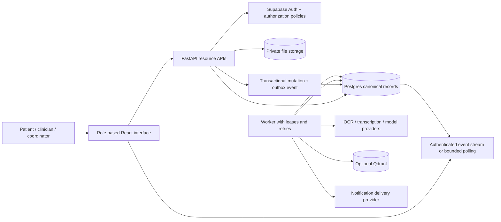

# Medora: scalability, frontend, backend, and UX roadmap

Prepared 10 October 2026. This is a planning deliverable; application code and database schemas have not been changed.

## 1. Recommended direction

Keep React, FastAPI, Supabase Auth/Postgres/private Storage, and optional Qdrant. Evolve the backend into a modular application with a separate worker process. Replace whole-workspace persistence with resource APIs and canonical records. Build each role's interface around its daily work, with explicit patient context, permissions, data provenance, and save states.

The immediate priority is trustworthy behavior. More infrastructure will not correct unintended access grants, ambiguous patient identity, synthetic analytics in an authenticated workspace, or successful-looking AI failures. Resolve those first, then improve read/write efficiency and introduce durable processing.

A modular application and worker provide useful isolation without the operational cost of distributing every feature across microservices. Introduce additional services only when measured bottlenecks, independent ownership, or deployment requirements justify them.

## 2. Evidence and verification limits

The review inspected application components, the API client, autosave, authentication, persistence, document processing, AI providers, migrations, tests, and existing audit documents.

| Check | Observed result | Interpretation |
| --- | --- | --- |
| Frontend TypeScript | Passed | Current source satisfies its configured TypeScript checks. |
| Frontend source/render suite | 26 passed | Covers specified source and server-render behavior; does not establish browser interaction or visual quality. |
| Backend suite, after running outside the restricted sandbox | 24 passed, 4 failed | Reveals contract drift and security/trust regressions described below. |
| Production build and bundle analysis | Not performed for this roadmap | Bundle sizes and startup performance are unmeasured. |
| Load tests, production telemetry, database query plans | Not available | Capacity and latency figures below are proposed acceptance targets. |
| Fresh desktop/mobile screenshots and usability sessions | Not captured | UX recommendations derive from code and workflow structure, not a new visual/accessibility audit. Existing audit screenshots are historical. |

The four backend failures should be treated differently:

- Semantic retrieval returns `semantic-qdrant` while the test expects `semantic`: decide the public contract, regenerate types where applicable, and update the test if the renamed value is intended.
- Missing recording consent returns 400 while the test expects 403: agree on the contract. A status disagreement alone does not demonstrate a consent bypass.
- Patient access to transcription returns 503 rather than the expected 403: the endpoint has no professional-role check. Decide whether transcription is a general patient tool or a clinician encounter tool; separate the capabilities if both are needed.
- An unconfigured chat provider returns 200 rather than the expected 503: the fallback presents an answer as if AI worked and says the question was noted in the health dossier, without saving it in this path.

Useful source anchors:

| Area | Source |
| --- | --- |
| Whole-workspace saves and fire-and-forget synchronization | [app.py:232](/C:/Users/Dell/Downloads/medora-fullstack/medora-fullstack/backend/medora/app.py:232) |
| Grants, profile lookups, and account scanning | [store.py:171](/C:/Users/Dell/Downloads/medora-fullstack/medora-fullstack/backend/medora/store.py:171) |
| Current JSONB workspace and grant schema | [001_medora.sql:13](/C:/Users/Dell/Downloads/medora-fullstack/medora-fullstack/backend/migrations/001_medora.sql:13) |
| Autosave and shared-record state | [use-workspace.ts:7](/C:/Users/Dell/Downloads/medora-fullstack/medora-fullstack/frontend/lib/use-workspace.ts:7) |
| Eager role imports, navigation, and notifications | [workspace.tsx:13](/C:/Users/Dell/Downloads/medora-fullstack/medora-fullstack/frontend/components/medora/workspace.tsx:13) |
| Patient selection and directory rendering | [doctor.tsx:96](/C:/Users/Dell/Downloads/medora-fullstack/medora-fullstack/frontend/components/medora/doctor.tsx:96) |
| Illustrative clinic charts | [hospital.tsx:17](/C:/Users/Dell/Downloads/medora-fullstack/medora-fullstack/frontend/components/medora/hospital.tsx:17) |
| Provider retries and fallback behavior | [providers.py:34](/C:/Users/Dell/Downloads/medora-fullstack/medora-fullstack/backend/medora/providers.py:34) |

## 3. Correctness and trust before scale

### Access and QR passes

1. Restrict QR issuance to the patient or an explicitly delegated actor. The current generator accepts `patient_email` without checking access; signing a token must never substitute for authorization.
2. Bind scope, patient, expiry, issuer, and token identifier to the signed pass. Reject a request that tries to replace its signed access type. Prefer an opaque random token whose hash and grant definition live server-side, so passes can be revoked.
3. Store grant expiry and enforce it on every authorized read/write, including database policies and worker actions. Temporary intake currently persists a write grant while returning a read scope. Expiring the QR token does not expire that stored grant.
4. Separate viewing, editing care notes, scheduling, prescribing, administering an organization, and granting access. A `hospital` role is too broad to represent all of these actions.
5. Remove implicit grants from appointment synchronization and clinician directory changes. Existing appointments currently can re-grant revoked access; adding a patient email to a clinician workspace can create a write grant.
6. Separate directory membership, an encounter's participants, and consent. A patient appearing in a list must not grant record access.
7. Use explicit UUID relationships. Replace substring name matching with exact actor/resource identities; never select the first person with a similar name.

Acceptance: a clinician who knows a patient's email cannot access their records; temporary access expires server-side; revocation survives subsequent edits; authorization is checked on background work and streaming connections as well as initial requests.

### Truthful clinical and operational data

- Missing blood group must be `unknown`, not `O+`. Allergies must be structured records, with substance, reaction, source, verification status, and timestamp. Searching arbitrary workspace text for “penicillin” cannot establish an allergy or its severity.
- Keep patient-reported, imported, AI-extracted, and clinician-verified values distinguishable. Missing medication/allergy information must not be translated into a clinical safety claim.
- Remove synthetic weekly charts, provider slots, ratings, locations, ages, and clinical templates from authenticated production workflows. Where an external capability is unavailable, show the actual available action: save a request, contact a provider, or upload a record.
- A local appointment request is not a confirmed clinic booking. “Sent” requires a delivery action; “delivered” requires evidence from the provider; “read” requires a defined receipt.
- AI outage responses must state unavailability. A deterministic record summary can be offered with an explicit fallback label, source references, and no fabricated save claim.
- Retrieval similarity must not appear as a medical confidence percentage. Current citation scores are transformed into a minimum-looking match percentage; show relevant source excerpts instead, and reserve confidence claims for evaluated quantities.

## 4. Target architecture



Use one API codebase split into `auth`, `patients`, `organizations`, `access`, `appointments`, `encounters`, `documents`, `messages`, `notifications`, and `jobs`. Authorization and transaction boundaries belong in services; routers validate input and return typed responses. Provider adapters handle external errors without exposing raw provider bodies.

The event-stream box requires an actual authenticated publishing mechanism; Postgres does not automatically provide an application event stream. Begin with bounded, visibility-aware polling if the deployment cannot support long-lived connections. Introduce SSE or an approved realtime channel when its behavior under reconnects, permissions, and hosting limits is verified.

Keep private medical responses out of shared CDN caches. Reusable catalog data can be cached separately. Browser query caches must be scoped to user, organization, patient, and resource, and cleared on logout and access revocation.

## 5. Replace workspace blobs with resource storage

The current model saves the entire workspace after a 400 ms debounce, checks a single workspace version, caps its serialized size at approximately 1 MB, and limits individual collections to 1,000 rows. It includes document extraction content alongside everyday UI records. This produces unrelated edit conflicts and makes ordinary writes more expensive as records accumulate.

Do not simply raise those limits. Normalize the records that need identity, concurrency, searching, authorization, or lifecycle transitions. Retain JSONB for preferences and versioned structured analysis payloads.

| Entity | Essential fields and invariants |
| --- | --- |
| Organizations and memberships | Organization ID, user ID, professional permissions, active status. Cross-organization access requires an explicit relationship. |
| Patients and links to user accounts | Stable patient ID, optional account link, verified demographics. Family members require their own identities and dependent-access relationship. |
| Grants and QR passes | Subject, actor, organization context where applicable, capabilities, expiry, revocation, consent evidence, opaque token hash. |
| Appointments and slots | Patient, clinician, organization/resource IDs, UTC start/end, display timezone, status, version, idempotency key. |
| Encounters and clinical notes | Encounter ID, patient, participants, draft/reviewed/signed state, author, revisions, timestamps. Signing creates an immutable version; amendments remain traceable. |
| Documents and analyses | Owner/patient, storage object key, content hash, file metadata, extraction and analysis versions, processing status. Large extracted text loads separately. |
| Medications and dose logs | Medication record and provenance; individual scheduled/taken/missed events rather than one daily boolean. |
| Conversations and messages | Participants, sender, body, timestamps, server-assigned ordering, delivery state. |
| Notifications | Recipient, event, channel, scheduled time, delivery attempts, seen timestamp, verified delivery result. |
| Audit events and outbox/jobs | Actor/action/resource, correlation ID, event ID, attempts, lease, next retry, terminal state. Avoid duplicating medical text in audit metadata. |

Examples of additive endpoints:

```text
GET   /api/v2/dashboard
GET   /api/v2/patients?query=...&cursor=...&limit=25
GET   /api/v2/patients/{id}/summary
GET   /api/v2/patients/{id}/documents?cursor=...
POST  /api/v2/appointments
PATCH /api/v2/appointments/{id}        # expected version, explicit permitted fields
POST  /api/v2/encounters/{id}/notes
POST  /api/v2/documents/{id}/analysis  # 202 with job ID
GET   /api/v2/jobs/{id}
POST  /api/v2/access-requests
```

Return domain-specific permissions and server versions. Use cursor pagination with stable ordering and a unique ID as tie-breaker. Reject excess limits. Create dashboard aggregates server-side rather than transferring every appointment or document to compute counts.

Start indexes with actual query predicates: appointment `(organization_id, starts_at, id)` and `(clinician_id, starts_at, id)`; document `(patient_id, created_at, id)`; message `(conversation_id, created_at, id)`; grants keyed by subject and actor; pending jobs by runnable time. Verify plans and write overhead before adding more indexes.

Protect slot reservation inside a database transaction. Fixed single-capacity slots can use a unique active reservation; variable-duration visits need overlap protection scoped to clinician and resource. PostgreSQL unique/exclusion constraints can enforce cross-row invariants; a JSON list check in one patient's workspace cannot prevent two different patients booking the same clinician. [PostgreSQL constraints](https://www.postgresql.org/docs/current/ddl-constraints.html)

Because current persistence uses Supabase REST calls, implement multi-record transactions with a narrowly scoped database function/RPC or introduce a pooled Postgres repository. Several consecutive REST requests do not form one transaction. Choose one transactional write path for each resource.

## 6. Durable backend work and throughput

### Outbox and job processing

Commit each domain mutation and its event in the same transaction. Workers claim jobs, release database locks promptly, process outside the transaction, and complete only while holding a valid lease. A worker crash leaves recoverable work; lease expiry makes it runnable again.

Use idempotency keys per event and handler, bounded attempts, exponential backoff with jitter, a terminal failure state, and an operator retry action. A delivered notification and a database acknowledgment can fail independently, so require delivery-provider idempotency or explicit deduplication. Do not claim exactly-once delivery.

A Postgres outbox is a reasonable first implementation. `FOR UPDATE SKIP LOCKED` supports multiple queue consumers avoiding row contention; use it for claiming work rather than ordinary record reads. A dedicated queue becomes appropriate when measured backlog or processing volume requires it. [PostgreSQL SELECT locking](https://www.postgresql.org/docs/current/sql-select.html)

Replace cross-workspace record copying with one canonical appointment/message and authorized projections. This removes stale duplicates and the requirement to rewrite several people's workspaces after every save.

### API execution

- Batch grant/profile lookups: the current grant list performs sequential per-profile requests. Fetch related identities in a joined query or bounded batch.
- Remove `all_profiles()` from each save. Query the specific referenced actors or resources.
- Keep blocking SQLite/file operations outside async request execution. Local SQLite remains a development option, with explicit connection closure, suitable indexes, and contention testing.
- Keep a bounded shared HTTP client and connection limits. Apply per-provider concurrency limits and an overall request deadline; classify permanent input/auth failures separately from retryable timeouts, 429, and selected 5xx responses.
- Bound the total AI fallback budget. The current nested provider fallbacks can produce many sequential calls. A small approved fallback list and a single attempt budget make latency and spend predictable.
- Replace process-local rate limits with a shared limit where multiple API instances run. Limit by verified user/organization and expensive capability, with separate login controls. Trust forwarded addresses only from a configured trusted proxy.
- Use same-origin API routing where supported to simplify cookies and refresh behavior. Preserve explicit allowed origins, and extend CORS methods/headers deliberately when adding PATCH, idempotency keys, or version preconditions.
- Validate external response schemas and expose safe error codes plus a request ID. Raw model/provider errors should not become client-facing details.

## 7. Documents, voice, AI, and retrieval

Upload flow: request an authorized upload intent, enforce size/type and object ownership, upload privately, then finalize after validating object metadata/content. Signed direct uploads can reduce API payload pressure; they need unfinished-object cleanup and short-lived credentials. Keep an API-upload option until the hosting/storage behavior is verified.

Process documents asynchronously with explicit states: uploaded, queued, extracting, analysing, ready, failed. Indexing has a separate status because a useful summary can exist even when semantic search is unavailable. Save a job ID and timestamps, so users can leave the page and return.

Deduplicate with content hash plus model, prompt, and extraction version within an authorized ownership boundary. Do not use cross-patient caches that expose another person's result. Limit document pages, audio duration, tokens, job concurrency, and daily organization spend.

For retrieval, preserve owner/patient filters and allowed-document filters, recheck access before responding, include source versions, and remove vectors on deletion. Use embeddings compatible with the configured collection dimension. Model or dimension migrations require a separate versioned collection and controlled reindexing.

For clinical drafts, return validated structured objects with unknown values represented explicitly. Pin model/prompt versions in saved analysis metadata. Distinguish generated drafts from reviewed/signed clinician records. A translation is another attributed derived record; it must not silently overwrite the original.

Voice must clearly show recording, paused, stopped, uploading, transcribing, and failed states. Obtain consent before capture, explain retention, provide a stop control throughout capture, and release microphone/audio resources when leaving the view. Preserve a reviewed transcript separately from temporary audio according to an explicit retention policy.

## 8. Frontend performance and maintainability

| Current pressure | Proposed change | How to verify |
| --- | --- | --- |
| Workspace statically imports patient, doctor, hospital, common views, and modals | Split role roots and heavy features; load voice, scanner, prescription editor, and analytics on demand | Analyze production chunks; confirm unrelated role/editor/chart code is absent from the initial route chunk |
| Navigation uses hash views in a large shared component | Add persistent section routes and a shared shell; retain existing links during migration | Direct navigation, refresh, back/forward, and an authorized patient deep link all work |
| Entire workspace is the server-state unit | Resource query hooks with bounded pages, summaries, and independently invalidated caches | Changing a task does not resend extracted documents or invalidate unrelated patient records |
| All directory rows render and filter client-side | Server search and cursor pagination; retain filters in the URL; virtualize only if measured necessary | Search remains responsive with large datasets; keyboard focus survives pagination |
| Network behavior differs for JSON, audio, and downloads | Centralize refresh, deadlines, error mapping, cancellation, and correlation IDs | Expired session recovery behaves consistently; canceled requests cannot update the next patient |
| Many large components, inline styles, and `any` values | Split feature components, typed domain DTOs, shared form/state components, and design tokens | Reduce duplicated behavior; typecheck catches contract changes |

Dynamic imports reduce initially needed client JavaScript; Next supports dynamic imports and React lazy/Suspense. This project also uses Vinext, so verify the chosen mechanism with its actual build rather than assuming complete Next runtime equivalence. [Next lazy loading](https://nextjs.org/docs/app/guides/lazy-loading)

Memoize only demonstrably expensive selectors, and build lookup maps where repeated `.find()` calls make table rendering quadratic. Do not use memoization as a substitute for bounded queries. Code formatting and small feature modules make permission-sensitive code easier to review.

Patient identity must be the same in routing, query keys, drafts, API requests, and authorization. Currently selecting a directory patient sets `ctx.selected`, while shared workspace ownership is managed separately; several clinical tools pass `ctx.ownerId`. Consolidate this into one authorized patient-context object and cancel previous patient requests on switching.

Keep autosave for reversible drafts. Show saved timestamp, saving, unsaved, offline, and conflict states. Serialize writes per resource, use versions, and offer an explicit conflict comparison. Never silently merge signed notes, prescriptions, consent, or identity changes. Clearing a directory, deleting a file, granting access, and signing a note need explicit commands and appropriate review.

## 9. Product UX: make the three roles useful in real work

### Shared visual and interaction direction

Preserve Medora's brand, but shift the workspace toward readable, task-oriented layouts. Use a restrained blue/teal palette, neutral surfaces, consistent spacing, one primary action per section, and clear typography. Keep illustrative marketing treatments on the landing page; daily work screens should favor relevant records and actions.

Use cards for summaries and detail drawers; tables for clinician/coordinator lists; timelines for record history. Define reusable record headers, permission banners, status badges, action menus, error panels, and form layouts. Clinical uncertainty needs words and provenance, not a green success badge.

Proposed top-level navigation:

| Role | Primary sections | Secondary tools |
| --- | --- | --- |
| Patient | Today, Visits, Records, Medications, Care team | Family switcher, access settings, Ask Medora, account preferences |
| Clinician | Today, Patients, Encounters, Inbox | Documents, prescribing tools within an encounter, referrals, settings |
| Coordinator | Operations, Appointments, Queue, Patients, Reports | Waiting list, communications, organization/team administration |

This groups the existing features rather than making every AI tool a competing top-level destination.

### Patient: prepare for the next visit

The first screen shows the next actual upcoming visit, incomplete preparation, medication reminders grounded in recorded schedules, and recent document jobs. If there is no next visit, present a relevant onboarding action rather than an inactive appointment preparation button.

The visit detail contains time and timezone, provider confirmation state, location/video details when available, cancellation policy when supplied, preparation checklist, linked records, and questions. Distinguish an imported external calendar event from a clinic-managed booking. The calendar code currently emits floating local times and ignores TZID semantics on import; store UTC plus clinic timezone and test daylight-saving changes.

Document UI uses a list with filename, source, upload time, processing state, and last update. Opening a file shows the original and an attributed explanation, source links, editable questions, and permission-aware sharing. Show failures inline with a retry action; retain the original if analysis fails.

Care-team UI shows verified recipient identity, exact permissions, expiry, and last relevant access event. Temporary access is clearly different from an ongoing connection. Revocation shows the resulting server state.

### Clinician: one encounter, one patient context

The day view prioritizes today's visits, unsigned drafts, and messages needing attention. Patient search opens an authorized record route; a registry entry without consent offers an access request.

Keep a persistent patient header with name, verified identifiers where available, current permission, encounter state, and expiry. Show allergies/medications only with provenance and verification status; avoid defaults. The encounter area places source records beside the transcript/note editor. Generated output is a draft; review and sign are explicit.

Prescribing tools belong inside a patient encounter. Retain clinician edits on provider failure and show which suggestions were generated, which were reviewed, and which are missing required data. Role-specific permissions determine who can sign or prescribe.

Signing a note creates a server-confirmed record version and audit event. Subsequent changes are amendments. Directory removal is a membership action; it must not erase clinical history or recreate access.

### Hospital/coordinator: operate today's queue

Default to the organization, clinic date/timezone, live appointment list, queue state, and waiting time calculated from recorded check-in timestamps. Provide department/clinician filters and a compact layout suitable for repeated desk use.

Check-in, consultation start, completion, cancellation, and no-show are server-validated transitions. Concurrent actions must not create impossible states. Show the last update and reconnect state; do not call a stale snapshot “live.”

Reports aggregate actual events. With insufficient data, show the data range and missing-data state rather than extrapolated demo trends. Exports are scoped, paginated/queued if large, and audited. Communications separate drafts, scheduled reminders, sent messages, failed delivery, and received replies.

### Essential states and accessibility

Every major resource view must handle loading, genuine empty state, filtered empty state, partial data, read-only access, revoked/expired access, offline, conflict, processing, and recoverable failure. Use truthful next actions for each.

Verify keyboard navigation, visible focus, dialog focus/return, screen-reader labels, non-color status indicators, reduced motion, readable contrast, 200% zoom, long names, and narrow mobile screens. Aim for generous touch targets. A clinician table can use an accessible horizontal scroller on small screens; patient cards should reflow naturally.

Replace the fixed notification badge with unread server records. Retain one clear demo boundary in demo mode, and remove demo-account shortcuts and invented operational counts from production mode. User-visible text should say what an action actually completed.

## 10. Delivery sequence and acceptance gates

Complexity estimates are relative: S = localized change; M = several modules plus tests; L = schema/API/UI migration or operational integration. They are not delivery dates.

| Order | Work package | Complexity | Dependency | Acceptance gate |
| --- | --- | --- | --- | --- |
| 1 | QR authorization, explicit grants, expiry/revocation, professional capability decisions | M | None | Unauthorized access and re-grant regressions fail closed |
| 2 | Truthful AI failure states, structured unknown data, production/demo boundaries | M | None | No fake saved/confirmed/delivered/clinical-success claims |
| 3 | Resolve four backend failures; add security and concurrency regressions | M | 1–2 | Intended contracts pass; failures are corrected, not merely suppressed |
| 4 | Measure production chunks, route/network timings, query counts, payload sizes | S | Reproducible build | Saved baseline and repeatable benchmark fixtures |
| 5 | Establish organization/patient identities and resource permissions | L | 1 | Explicit cross-account and cross-organization isolation |
| 6 | Canonical appointments, transactional reservation, resource versions, outbox | L | 5 | Concurrent booking and retry tests preserve one valid reservation |
| 7 | Patient context/routes, shared shell, role navigation, draft/save states | M | 5 | Switching patients cannot reuse another patient's data or drafts |
| 8 | Document resource APIs and durable processing UI | L | 5–6 | Worker restart/retry works; summaries survive indexing failures |
| 9 | Paginated patient lists, grant batching, dashboard aggregates, lazy features | M | 4–8 | Measured request/byte/chunk reduction with no behavior regression |
| 10 | Real messages/notifications, queue refresh, organization reports | L | 6 | Delivery and freshness labels match observed server state |
| 11 | Role workflow polish, accessibility, desktop/mobile interaction verification | M | 7–10 | Core tasks completed with keyboard and narrow-screen layouts |
| 12 | Load/resilience tests, staged migration, monitoring, pilot release | L | All relevant above | Agreed SLOs met; rollback and restore exercised |

First implementation milestone: fix authorization and truthfulness, resolve intended API contracts, unify patient context, batch grants, introduce real save/error states, and capture performance baselines. This creates a reviewable improvement without prematurely rewriting the entire application.

## 11. Migration and operational plan

Use additive migrations and `/api/v2` resource endpoints while retaining the v1 reader during transition. For each domain, define its sole authoritative writer, backfill existing JSON records with validation, preserve an ID mapping, compare counts and representative fields, then switch reads and writes behind a controlled rollout.

Do not enable unsupervised dual writes. If temporary dual writing is unavoidable, make reconciliation and rollback explicit. Resolve ambiguous names, `p1` placeholders, duplicate appointment copies, and manually registered patients before assuming account IDs are record IDs.

Keep the original workspace snapshot as a restricted migration backup, not a second editable source. Rollback after new writes must preserve the new canonical records; switching readers back alone can lose updates. Migration checks must be patient- and organization-scoped.

Deploy APIs and workers independently from the same tested codebase. Include migration compatibility checks, health/readiness, worker backlog, scheduled cleanup, backups, and an exercised restore. Keep development/demo data separate from production. Use staged releases and measure errors before expanding rollout.

Observability should record request IDs, safe resource identifiers, endpoint latency, query/request counts, queue age, retries, model/version, token/spend counts, provider availability, and permission denials. Redact request bodies, transcripts, document excerpts, cookies, tokens, and signed URLs from routine logs and telemetry.

## 12. Proposed success criteria

These are initial targets for agreement and measurement, not claims about the current application or guaranteed capacity.

| Dimension | Proposed criterion |
| --- | --- |
| Browser experience | At the 75th percentile, LCP <= 2.5 s, INP <= 200 ms, CLS <= 0.1, measured separately for mobile and desktop |
| Routine list/summary APIs | p95 <= 500 ms in the chosen deployment region under the agreed load; include authorization and database time, exclude queued AI completion |
| Ordinary writes | p95 <= 750 ms; return a confirmed resource version, with no unrelated workspace rewrite |
| Payloads | Begin with a <= 100 KB uncompressed dashboard target and bounded list pages; file contents/extraction excluded from normal lists |
| Initial client JS | Establish a baseline, then remove unused role, scanner, voice, chart, and editor chunks from initial navigation; set byte budgets after measurement |
| Queue behavior | At agreed load, p95 job-start delay <= 5 s; completion targets by document/audio size and provider; no lost jobs on restart |
| Booking correctness | Concurrent requests for one single-capacity slot create one active reservation; retries do not create duplicates |
| Access correctness | Revocation blocks subsequent reads/writes; temporary grants expire; stale caches/events do not expose another account |
| Product truthfulness | No synthetic charts in production; no “saved/sent/confirmed” label without a corresponding successful operation |
| UX completion | A patient can prepare a visit, a clinician can open/review/sign the correct encounter, and a coordinator can process the queue, including failures and permissions |

The browser targets use the current Core Web Vitals definitions. [Web Vitals](https://web.dev/articles/vitals)

Start load tests with a documented workload, for example 100 concurrent active sessions and a 90/10 read/write mix, then step up until targets fail. Seed representative history, such as an organization directory with 10,000 patient entries and a patient with 1,000 document metadata records. Keep AI-job load separate from ordinary API load, then test interaction between them. These are test fixtures, not certified capacity statements.

Required resilience tests: duplicate jobs, worker termination, provider 429/timeouts, refresh expiration, concurrent note edits, concurrent bookings, revoked access during processing, document deletion during indexing, DST/timezone changes, mobile connection loss, and retry after partial external delivery.

Before release, complete fresh visual/browser verification and production build checks. Current source/render tests should remain useful unit checks, complemented by real browser workflows and database-backed transaction tests.
